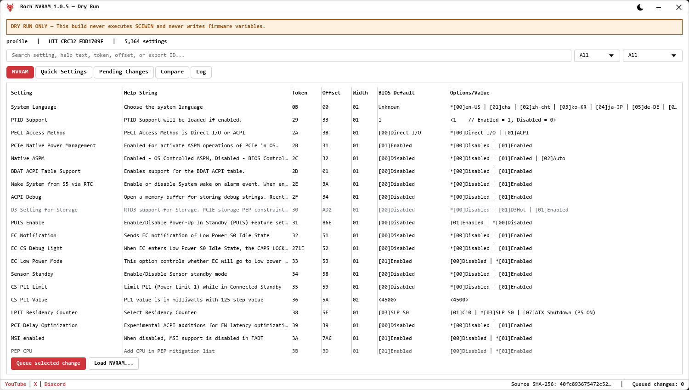

# Roch NVRAM 1.1.0

An editor for AMI BIOS settings on Windows and Linux. It reads the live NVRAM (with
AMI's SCEWIN on Windows, natively on Linux), lets you review and queue changes, and
writes them back only after a backup, a fresh check that nothing moved, and a
value-by-value verification.



> **This program writes firmware settings.** Wrong voltage, clock, memory, or boot values
> can stop a PC from starting. Keep Clear CMOS or BIOS Flashback within reach.

## Download and run

1. Download `RochNVRAM-1.0.5-win-x64.zip` from
   [Releases](https://github.com/1xroch/Roch-NVRAM/releases) and extract the whole folder.
   `roch-nvram.exe` needs `scewin/` beside it.
2. Run `roch-nvram.exe` and approve the administrator prompt.

There is nothing to install. Backups, the catalog, and the theme live in
`%LOCALAPPDATA%\NVRAM`, so upgrading keeps them.

## Linux

1. Download `RochNVRAM-1.1.0-linux-x86_64.tar.gz` from
   [Releases](https://github.com/1xroch/Roch-NVRAM/releases), unpack it and run
   `./install.sh`. That puts `roch-nvram` in `~/.local/bin` and **Roch NVRAM** in your
   launcher, as your user.
2. Open it and press **Export**.

Linux has no SCEWIN, and none is needed. An AMI BIOS publishes its setup database (the
HII database SCEWIN reads) through the `HiiDB` UEFI variable; Roch NVRAM reads the
setting names, options and defaults from there and the current values from the UEFI
variables in `/sys/firmware/efi/efivars`. The export is written in AMISCE's layout,
so everything below works the same. Writing goes through a small root helper that
re-reads the database and changes only the bytes of the queued settings, only to a
value the setting allows.

- **The password.** Reading the setup database (it lives in firmware memory) and
  writing need root, so both ask through pkexec. The database is kept per BIOS build,
  so the read asks once, and again after a BIOS update. To stop the prompts:
  `sudo ~/.local/bin/roch-nvram setup`. It installs a root-owned copy at
  `/usr/local/bin/roch-nvram` and a polkit rule that lets you start only its two
  helpers without a password. The trade: anything running as you could then change
  BIOS settings without asking. `roch-nvram setup --status` shows what is in place;
  `sudo roch-nvram setup --undo` removes it. Run setup again after updating.
- **What is left out.** Settings in variables the running system cannot read
  (volatile or boot-time-only ones, such as `SetupVolatileData`) are not exported.
- **Backups** live in `~/.nvram/backups`, as on Windows under `%LOCALAPPDATA%`.
- `roch-nvram --export nvram.txt` reads the live NVRAM to a file with no window.
- Needs an AMI UEFI BIOS (it says so if the `HiiDB` variable is missing), x86-64 and
  glibc 2.35 or newer. Tested on a Gigabyte Z890 AORUS TACHYON ICE (BIOS F7a).

## How it works

- **Export** reads the live NVRAM into the table. Nothing touches the firmware until you
  press it.
- **Queue** changes from the NVRAM table (double-click a row) or the **Quick Settings** tab.
  Review them under **Pending Changes**.
- **Import** re-reads the NVRAM first and refuses to continue if the BIOS layout changed or
  a value moved since you queued it. Then it backs everything up, writes the changes, reads
  the NVRAM again, and checks every value. When it verifies, **Restart now** reboots.
- **Load NVRAM** restores an older `nvram.txt`, for example after a Clear CMOS. It compares
  the file with the live NVRAM and queues only the differences, so the same checks apply.

Some boards open BIOS setup on the next boot after a memory setting changes. That is the
board retraining the RAM, not a failed import.

## Tabs

| Tab | What it does |
| --- | --- |
| NVRAM | Every setting in export order. Search names, help text, tokens, and offsets. |
| Quick Settings | CPU, RAM, and GPU/PCIe overclocking controls on one page, from a per-board preset. |
| Pending Changes | The queue, with Before and After. Can also save a modified `nvram.txt` or a transaction JSON without writing anything. |
| Compare | Two exports side by side, showing which values changed. Exports a CSV. |
| Log | Every NVRAM the tool has read, archived. Double-click to open one. |

Settings are matched by **token + offset + width**, never by name, and anything the parser
can't read unambiguously is greyed out instead of guessed.

## Quick Settings presets

The bundled preset is **MSI Z790 (LGA 1700 DDR5)**. Presets are per vendor because MSI,
ASUS, ASRock, and Gigabyte lay out their NVRAM differently. To build one for another board,
export once at stock and once tuned, then run:

```bash
make-quick-settings.exe stock.txt tuned.txt --vendor ASUS --board "ROG Maximus Z790 Apex" --name "ASUS Z790 (LGA 1700 DDR5)" --platform asus-z790-ddr5 --out assets/quick_settings/asus_z790_ddr5.json
```

An `assets/quick_settings/` folder beside the executable overrides the built-in presets.

## If something goes wrong

- **Values didn't verify?** Check that "Password protection of Runtime Variables" is
  Disabled in BIOS. With it on, SCEWIN exits cleanly but its writes are dropped.
- **To undo an import**, use Load NVRAM on `nvram_before.txt` from its folder in
  `%LOCALAPPDATA%\NVRAM\backups`.

## Offline mode

`roch-nvram.exe --offline --profile profile.json --nvram nvram.txt` opens an export without
SCEWIN, administrator rights, or any firmware access. Make the profile with
`scewin-parser.exe nvram.txt --output profile.json`.

## Building

Needs Rust 1.87 or newer: the MSVC target on Windows, the GNU one on Linux.

```bash
cargo build --release
cargo test
```

The tests use a small synthetic export in `tests/fixtures/` and synthetic HII databases,
and never run SCEWIN or touch firmware.

## Credits and licence

- [SCEHUB](https://github.com/ab3lkaizen/SCEHUB) by ab3lkaizen, whose `Export.bat` and
  `Import.bat` this tool is built around.
- AMISCE (SCEWIN) is American Megatrends' utility. On Windows every read and write goes
  through it. The Linux reader follows the UEFI specification's HII package and IFR
  formats and does not use AMI code.

GPL-3.0-or-later; see [LICENSE](LICENSE). The bundled AMI binaries are **not** covered by
that licence; see [THIRD_PARTY_NOTICES.txt](THIRD_PARTY_NOTICES.txt).
