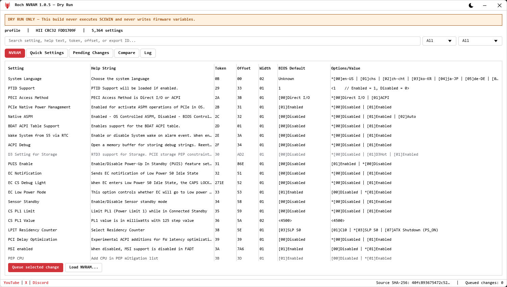

# Roch NVRAM 1.0.5

A Windows editor for AMI BIOS settings. It reads the live NVRAM with AMI's SCEWIN, lets
you review and queue changes, and writes them back only after a backup, a fresh check
that nothing moved, and a value-by-value verification.



> **This program writes firmware settings.** Wrong voltage, clock, memory, or boot values
> can stop a PC from starting. Keep Clear CMOS or BIOS Flashback within reach.

## Download and run

1. Download `RochNVRAM-1.0.5-win-x64.zip` from
   [Releases](https://github.com/1xroch/Roch-NVRAM/releases) and extract the whole folder.
   `roch-nvram.exe` needs `scewin/` beside it.
2. Run `roch-nvram.exe` and approve the administrator prompt.

There is nothing to install. Backups, the catalog, and the theme live in
`%LOCALAPPDATA%\NVRAM`, so upgrading keeps them.

## How it works

- **Export** reads the live NVRAM into the table. Nothing touches the firmware until you
  press it.
- **Queue** changes from the NVRAM table (double-click a row) or the **Quick Settings** tab.
  Review them under **Pending Changes**.
- **Import** re-reads the NVRAM first and refuses to continue if the BIOS layout changed or
  a value moved since you queued it. Then it backs everything up, writes the changes, reads
  the NVRAM again, and checks every value. When it verifies, **Restart now** reboots.
- **Load NVRAM** restores an older `nvram.txt`, for example after a Clear CMOS. It compares
  the file with the live NVRAM and queues only the differences, so the same checks apply.

Some boards open BIOS setup on the next boot after a memory setting changes. That is the
board retraining the RAM, not a failed import.

## Tabs

| Tab | What it does |
| --- | --- |
| NVRAM | Every setting in export order. Search names, help text, tokens, and offsets. |
| Quick Settings | CPU, RAM, and GPU/PCIe overclocking controls on one page, from a per-board preset. |
| Pending Changes | The queue, with Before and After. Can also save a modified `nvram.txt` or a transaction JSON without writing anything. |
| Compare | Two exports side by side, showing which values changed. Exports a CSV. |
| Log | Every NVRAM the tool has read, archived. Double-click to open one. |

Settings are matched by **token + offset + width**, never by name, and anything the parser
can't read unambiguously is greyed out instead of guessed.

## Quick Settings presets

The bundled preset is **MSI Z790 (LGA 1700 DDR5)**. Presets are per vendor because MSI,
ASUS, ASRock, and Gigabyte lay out their NVRAM differently. To build one for another board,
export once at stock and once tuned, then run:

```bash
make-quick-settings.exe stock.txt tuned.txt --vendor ASUS --board "ROG Maximus Z790 Apex" --name "ASUS Z790 (LGA 1700 DDR5)" --platform asus-z790-ddr5 --out assets/quick_settings/asus_z790_ddr5.json
```

An `assets/quick_settings/` folder beside the executable overrides the built-in presets.

## If something goes wrong

- **Values didn't verify?** Check that "Password protection of Runtime Variables" is
  Disabled in BIOS. With it on, SCEWIN exits cleanly but its writes are dropped.
- **To undo an import**, use Load NVRAM on `nvram_before.txt` from its folder in
  `%LOCALAPPDATA%\NVRAM\backups`.

## Offline mode

`roch-nvram.exe --offline --profile profile.json --nvram nvram.txt` opens an export without
SCEWIN, administrator rights, or any firmware access. Make the profile with
`scewin-parser.exe nvram.txt --output profile.json`.

## Building

Needs Rust 1.87 or newer with the MSVC target.

```bash
cargo build --release
cargo test
```

The tests use a small synthetic export in `tests/fixtures/` and never run SCEWIN.

## Credits and licence

- [SCEHUB](https://github.com/ab3lkaizen/SCEHUB) by ab3lkaizen, whose `Export.bat` and
  `Import.bat` this tool is built around.
- AMISCE (SCEWIN) is American Megatrends' utility. Every read and write goes through it.

GPL-3.0-or-later; see [LICENSE](LICENSE). The bundled AMI binaries are **not** covered by
that licence; see [THIRD_PARTY_NOTICES.txt](THIRD_PARTY_NOTICES.txt).
